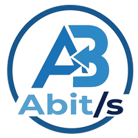

<p align="center">
  
</p>

<h1 align="center"> IGOR - ABit/s</h1>

<p align="center">Regia video di ABit/s</p>

Piccola regia video per Windows: una **finestra di regia** sul monitor principale e un'**uscita a tutto schermo** sul secondo monitor, dove si compongono segnali NDI, periferiche di acquisizione, video e immagini, un timer, un banner di testo in sovraimpressione e un teleprompter, organizzati in scene. L'interfaccia è in italiano o in inglese.

📖 **[Mini manuale (italiano e inglese)](docs/MANUALE.md)**

## Le due finestre

**Regia** (monitor principale)
- In alto la barra dei menu:
  - **File**: importa ed esporta la configurazione (file `.igor` con tutti gli elementi e le loro impostazioni) e il sottomenu **Uscita**: monitor della seconda finestra (con risoluzione e frequenza), fotogrammi al secondo dell'uscita (10, 15, 20, 24 o 25), colore di sfondo, mostra/nascondi uscita.
  - **Visualizza**: modalità studio, mostra/nascondi le istruzioni, ripristina la disposizione delle finestre, dettagli input in una finestra separata, lingua (italiano o inglese), mini manuale.
  - **Controllo remoto**: controller MIDI e Companion / Stream Deck.
- Sotto, tre zone: l'**anteprima** (o i due schermi della modalità studio), i **dettagli** dell'input selezionato e la **colonna degli input**. I bordi tra le zone si trascinano e si agganciano come una calamita alle misure naturali. In modalità studio anteprima e programma occupano tutta la larghezza e la colonna degli input scende accanto ai dettagli. La disposizione resta memorizzata, separata per le due modalità.
- I dettagli sono divisi in schede libere: all'inizio sono su 4 colonne (2 righe se sono più di 4), poi ognuna si sposta tenendo premuto il titolo e si allarga o si alza dal bordo destro, da quello inferiore o dall'angolo, in modo indipendente dalle altre (con una misura minima); se lo spazio in verticale è poco compare la barra di scorrimento. Un clic sul titolo senza trascinare, o sulla linguetta ▾, riduce la scheda a barra. Il pulsante ⧉ apre la scheda in una finestra separata da mettere dove si vuole (anche su un altro monitor); il ⧉ in basso a destra porta in una finestra tutti i dettagli input. Posizioni e misure restano memorizzate per ogni tipo di input.
- Nella colonna destra il pulsante blu **+**, il pulsante **Modalità studio** e l'elenco degli elementi dal primo piano allo sfondo, con *Visibile / Nascosto*. Le scene sono numerate dall'alto (Scena 1, Scena 2…): il numero serve per MIDI e Companion.
- Il pulsante **+** apre una finestra in cui si sceglie il tipo di input (**scena**, **segnale NDI**, **periferica di acquisizione**, **media**, **timer**, **Banner di Testo**, **TelePrompt**), poi la sorgente NDI o la periferica dall'elenco (oppure il file, per i media) e la scena in cui metterlo. Un doppio clic aggiunge subito.
- I monitor hanno lo stesso numero che usa Windows.
- Colori: rosso per ciò che è in onda e per il tasto *Elimina*, verde per l'anteprima, blu e grigio del logo IGOR per i comandi (CUT blu, FADE grigio).
- Gli elementi dell'elenco si trascinano con il mouse per cambiare l'ordine: una linea verde mostra dove finiranno e lo spostamento avviene solo al rilascio. Rilasciando un input sopra una scena, l'input entra nella scena; tenendo premuto **Ctrl** al rilascio lo stesso input viene messo anche in quella scena (copia collegata, con una sola sorgente).
- Nell'anteprima si trascina un elemento per spostarlo e uno dei quattro angoli per ridimensionarlo (Maiusc mantiene le proporzioni); gli elementi si agganciano a bordi e centro.
- Per ogni elemento: misura e posizione in pixel sull'uscita, aggiornate in tempo reale; posizione e misure in % dello schermo oppure in pixel (selettore *% / px*), *Schermo intero*, *Centra*, *Proporzioni 16:9*; *Solo questo* (mostra in uscita solo quell'input), *Sopra / Sotto* per l'ordine; in basso a sinistra, sempre visibili, *Ripristina misure* (riporta posizione, misure e impostazioni ai valori iniziali, tenendo sorgente e testo) e il tasto rosso *Elimina input*, che toglie l'input selezionato e chiude la sua sorgente.
- Per NDI, acquisizione e media: ritaglio (crop) trascinando le maniglie arancioni a metà dei lati e adattamento *Adatta* (mantiene le proporzioni), *Riempi* (mantiene le proporzioni e taglia), *Deforma*.
- Accanto a ogni colore il contagocce 💧 preleva un colore da qualsiasi punto dello schermo (anche da altre finestre o dal secondo monitor) oppure da un'immagine aperta dal disco.

**Uscita** (secondo monitor)
- Si apre all'avvio, senza bordi, a tutto schermo sul monitor 2.
- Mostra un singolo input oppure la composizione di più input (per esempio segnale NDI + timer).
- Con un solo monitor collegato l'uscita appare come finestra di anteprima; collegando il secondo monitor si sposta da sola a tutto schermo.

## Scene e modalità studio

Una **scena** raccoglie più input (per esempio *countdown + sfondo* oppure *sfondo + videocamera*). In onda va una scena alla volta: mandandone in onda un'altra, gli input della prima spariscono e compaiono quelli della nuova, subito. Gli input fuori dalle scene restano sempre in onda (per esempio un logo o un banner).

Lo stesso input può stare in più scene: le copie condividono la sorgente (una sola apertura della videocamera, una sola ricezione NDI, una sola decodifica del video) e le impostazioni, mentre posizione e misure sono di ogni scena. Le sorgenti di tutte le scene restano aperte, così il cambio di scena è immediato.

Senza modalità studio, *Manda in onda* su una scena la manda subito in uscita. Con la **modalità studio** (pulsante in alto a destra) la regia mostra due schermi:
- a sinistra l'**anteprima** della scena che andrà in onda (si modifica con il mouse come sempre);
- a destra quello che è **in onda** sul secondo schermo, ripreso dalla finestra di uscita a bassa risoluzione (640×360) e a 15 fotogrammi al secondo per pesare poco;
- in mezzo **CUT** (cambio immediato) e **FADE** (dissolvenza), con sotto la durata della dissolvenza. Dopo il cambio la scena che era in onda passa in anteprima, così CUT ripetuti alternano due scene.

## Elementi

**Timer**
- All'indietro (countdown; dopo lo zero continua con il segno +) oppure in avanti (cronometro, la durata fa da limite).
- Avvia / pausa / azzera, ±10 s e ±1 min anche in corsa; barra spaziatrice per avvio/pausa.
- Tre colori dei numeri: alla partenza (verde), quando si avvicina la scadenza (giallo, negli ultimi N secondi) e a tempo superato (rosso).
- Solo quando il tempo è scaduto (timer partito e arrivato a zero, o alla durata in avanti) i numeri lampeggiano e compare una cornice lungo i bordi dello schermo: tratteggiata o continua, che scorre, lampeggia da ferma o resta fissa, con velocità, colore e spessore a scelta.
- Quando il timer è fermo (prima dell'avvio o dopo *Azzera*) può mostrare data e ora, scegliendo se mostrare data, ore, minuti, secondi e millesimi.
- Colore dello sfondo (o trasparente), misura e tipo di carattere, grassetto.
- I numeri si rimpiccioliscono da soli se non entrano nel riquadro.

**Banner di Testo** (prima si chiamava *Frase*, poi *Banner*)
- Fascia nella parte bassa dello schermo (si può spostare).
- Se il testo è più lungo dello spazio disponibile scorre da destra a sinistra, altrimenti resta centrato.
- Velocità di scorrimento, colori, opacità della fascia, misura e tipo di carattere.

**TelePrompt**
- Testo che scorre dal basso verso l'alto, come un vero teleprompter, alla velocità scelta (si cambia anche in corsa).
- Testo scritto a mano, incollato da Word, Blocco note, Pages o TextEdit, oppure importato da file `.docx`, `.rtf`, `.txt`, `.html`: grassetto, corsivo, sottolineato, colori, evidenziatore, grandezze e allineamenti restano.
- Avvia / pausa, torna all'inizio, avanti e indietro di poco, salto a un paragrafo dall'elenco dei paragrafi (o con Pagina su / giù).
- Carattere, misura, grassetto, colore del testo e dello sfondo, interlinea, spaziatura tra le lettere, margini, allineamento.
- Specchio orizzontale (per il vetro del teleprompter) e verticale, linea di lettura con posizione e colore.
- Il testo è impaginato come sull'uscita anche nell'anteprima della regia, quindi va a capo negli stessi punti.

**Periferica di acquisizione**: schede di acquisizione, webcam, convertitori HDMI/SDI → USB (tutto ciò che Windows vede come videocamera).

**Segnale NDI**: elenco delle sorgenti NDI trovate in rete, qualità piena o bassa (meno banda).

**Media**: video (mp4, webm, mov, mkv…) e immagini (png, jpg, gif, webp…) dal disco. Per i video: riproduci / pausa, da capo, ripetizione continua e tre modi di riproduzione:
- *continua anche quando non è in onda*;
- *riproduci solo quando è in onda*;
- *riproduci in onda e riavvolgi quando esce*.

L'audio del video è *attivo*, *disattivato* oppure *segue l'onda* (si sente solo quando il video è in onda). "In onda" vuol dire visibile sul secondo schermo.

La scena (elementi, posizioni, testi, colori) viene salvata e ritrovata al riavvio.

## Controllo remoto

**Controller MIDI** (menu *Controllo remoto*): si sceglie un comando, si preme *Impara* e si tocca un tasto, un pad o una manopola del controller. Comandi: CUT, FADE, manda in onda o metti in anteprima la scena numero N, modalità studio, timer avvia/pausa e azzera, video in onda riproduci/pausa e da capo, TelePrompt avvia/pausa, più veloce, più lento, velocità con una manopola, paragrafo successivo e precedente, torna all'inizio, mostra/nascondi uscita.

**Companion / Stream Deck**: attivando *Accetta comandi via HTTP* IGOR risponde a indirizzi come `http://127.0.0.1:8765/api/cut` o `http://127.0.0.1:8765/api/program/2` (scena numero 2). In Companion si usa il modulo *Generic HTTP* con un'azione GET; la finestra elenca tutti gli indirizzi da copiare. Con l'opzione di rete si comanda IGOR anche da un altro computer.

## Scarica

L'ultima versione per Windows (installer e portable) è sempre qui: **[Releases → ultima versione](https://github.com/battacharlie/MyGobbo/releases/latest)**.

## NDI

NDI usa il modulo nativo [`@stagetimerio/grandiose`](https://github.com/stagetimerio/grandiose) (NDI SDK 6). È una dipendenza *facoltativa*: durante `npm install` scarica l'NDI SDK e compila il modulo. Se non ci riesce, l'app funziona lo stesso e nel pannello NDI compare un avviso.

Per compilarlo su Windows servono gli strumenti di compilazione C++ ([Visual Studio Build Tools](https://visualstudio.microsoft.com/visual-cpp-build-tools/) con "Sviluppo di applicazioni desktop con C++") e Python. La GitHub Action li ha già, quindi l'`.exe` creato lì include NDI.

## Avvio in sviluppo

Serve [Node.js](https://nodejs.org/) 20 o successivo.

```bash
npm install
npm start
```

## Creare l'eseguibile per Windows

Su un PC Windows:

```bash
npm install
npm run dist
```

Nella cartella `dist/` trovi:

- `IGOR-ABits-Setup-x.y.z.exe` – installer;
- `IGOR-ABits-x.y.z-portable.exe` – versione portable, da avviare senza installare.

Nei nomi dei file e dei collegamenti l'app si chiama "IGOR - ABits" perché Windows non ammette il carattere `/`.

In alternativa, ogni push su `main` fa partire la GitHub Action **Build Windows**, che crea gli stessi `.exe`: li scarichi da *Actions → Build Windows → Artifacts* (serve un account con accesso al progetto).

Per pubblicare una nuova versione per tutti basta aumentare `version` in `package.json` e unire in `main`: la Action crea la Release (es. `v0.3.0`) con i due `.exe` allegati. Se esiste `release-notes/vX.Y.Z.md`, il suo testo diventa la descrizione della Release.

## Ringraziamenti

La versione 0.4 nasce dai suggerimenti di:
- **MATTEO CASTALDO** – [filandolarete.eu](https://www.filandolarete.eu/)
- **MASSIMILIANO NARDI & LORENZO OLIVOTTO** – [studiovisio.it](https://studiovisio.it/)

## Loghi

- `assets/ABits_Logo.png` – logo aziendale (README e finestre dell'installer).
- `assets/IGOR_Logo.png` – logo del software (icona dell'app e intestazione della regia).
- `build/` contiene icona e immagini dell'installer generate dai loghi.

## Struttura

```
src/
  main.js              processo principale: finestre, monitor, scena, comandi
  ndi.js               caricamento facoltativo di NDI e ricerca delle sorgenti
  shared/layers.js     tipi di elemento, calcolo del timer, crop
  shared/render.js     disegno della scena (uscita e anteprima in regia)
  shared/i18n.js       lingua dell'interfaccia (testi inglesi in shared/i18n-en.js)
  shared/actions.js    comandi per MIDI e Companion
  remote.js            server HTTP per Companion / Stream Deck
  textimport.js        lettura dei file di testo per il TelePrompt (.docx, .rtf, .txt)
  control/             finestra di regia (textconv.js converte i testi incollati o importati, remote.js gestisce MIDI e Companion)
  display/             finestra di uscita (riceve NDI e periferiche)
  picker/              contagocce: foto degli schermi e scelta del colore
```

La scena vive nel processo principale e le due finestre ricevono lo stesso stato. Per consumare poco non c'è un ciclo che ridisegna a ogni fotogramma: i video sono elementi della pagina posizionati con CSS e composti dalla scheda video, il timer si aggiorna solo al cambio del secondo e banner e TelePrompt scorrono con un'animazione CSS. L'anteprima in regia mostra riquadri con il nome degli input invece dei video, così i flussi non vengono decodificati due volte. Il timer è basato sull'orario di avvio, quindi resta preciso anche se una finestra rallenta. I fotogrammi NDI vengono ricevuti direttamente nella finestra di uscita, senza passare dal processo principale.

Tutto ciò che compare in uscita è limitato a **25 fps** (`MAX_FPS` in `src/shared/layers.js`; dal menu *Uscita* si può scendere a 24, 20, 15 o 10): le periferiche di acquisizione vengono aperte a 25 fps al massimo, i fotogrammi NDI in più vengono scartati, i video dei media vengono copiati in uscita 25 volte al secondo, e banner, TelePrompt, dissolvenze e cornice del timer avanzano a scatti di 1/25 di secondo.
